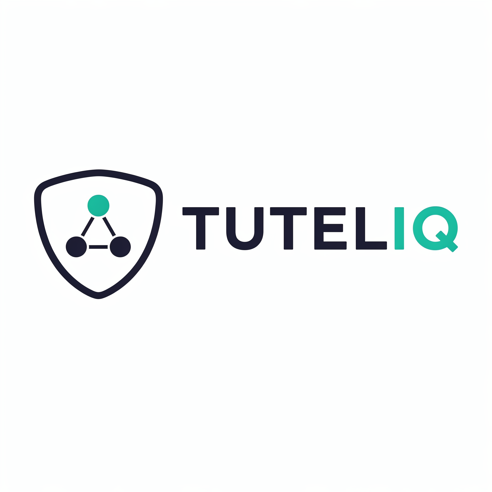

<p align="center">
  
</p>

<h1 align="center">Tuteliq Unity SDK</h1>

<p align="center">
  <strong>Official Unity SDK for the Tuteliq API</strong><br>
  AI-powered child safety analysis
</p>

<p align="center">
  <a href="https://github.com/Tuteliq/unity/actions"></a>
  <a href="https://github.com/Tuteliq/unity/blob/main/LICENSE.md"></a>
</p>

<p align="center">
  <a href="https://docs.tuteliq.ai">API Docs</a> •
  <a href="https://tuteliq.ai">Dashboard</a> •
  <a href="https://trust.tuteliq.ai">Trust</a> •
  <a href="https://discord.gg/7kbTeRYRXD">Discord</a>
</p>

---

## Installation

### Unity Package Manager (Git URL)

1. Open Window → Package Manager
2. Click "+" → "Add package from git URL..."
3. Enter: `https://github.com/Tuteliq/unity.git`
4. Click "Add"

### Manual Installation

1. Download the latest release
2. Extract to your `Packages/` folder

### Requirements

- Unity 2021.3+
- .NET Standard 2.1

---

## Keep your API key off the player's device

Your API key gives full access to your Tuteliq account. Anything shipped inside a game build can be extracted, so **do not put the key in a client build or a `MonoBehaviour` that ships to players**.

Use the SDK from code you control:

- **A dedicated server or headless Unity build** that relays chat: create the client there, with the key read from the server's environment.
- **Your own proxy**: point `baseUrl` at an endpoint you run. The game sends the player's session token as the key; your proxy checks the token, replaces it with your Tuteliq key and forwards the request.

```csharp
// On your dedicated server: the key comes from the environment, never from the build.
var client = new TuteliqClient(Environment.GetEnvironmentVariable("TUTELIQ_API_KEY"));

// In the game client: talk to your proxy, which holds the real key.
var client = new TuteliqClient(playerSessionToken, baseUrl: "https://moderation.your-game.example");
```

The examples below assume `client` was created in one of these ways.

---

## Quick Start

```csharp
using Tuteliq;

var result = await client.AnalyzeAsync("Hello world");

switch (result.Action)
{
    case ModerationAction.Block:
    case ModerationAction.ImmediateIntervention:
        // Do not deliver the message.
        break;
    case ModerationAction.FlagForReview:
        // Send it to your moderation queue.
        break;
    default:
        // None or Monitor: deliver it.
        break;
}
```

---

## Moderation decisions

Every detection result carries `RecommendedAction`, a fixed set of values ordered weakest to strongest, and `Action`, the same value as a `ModerationAction` enum. **Base moderation decisions on it**, not on `RiskScore`, `RiskLevel` or a boolean such as `IsBullying`.

| Action | Meaning |
|--------|---------|
| `None` | No signal |
| `Monitor` | Log it; no person needs to look |
| `FlagForReview` | Queue for a moderator |
| `Block` | Withhold or limit the content |
| `ImmediateIntervention` | Crisis path: act now |

```csharp
var action = result.Action;

if (ModerationActions.ShouldWithhold(action)) { /* Block or stronger */ }
if (ModerationActions.NeedsReview(action))   { /* FlagForReview or stronger */ }

// Combine several results: the most severe wins.
var combined = ModerationActions.Strongest(new[] { bullying.RecommendedAction, unsafeResult.RecommendedAction });
```

A value this SDK version does not recognise (from a newer API) is read as `FlagForReview`, so it reaches a person instead of being treated as safe.

---

## API Reference

### Initialization

```csharp
using Tuteliq;

var client = new TuteliqClient(
    apiKey: apiKey,
    timeout: 30f,        // Request timeout in seconds
    maxRetries: 3,       // Retries after the first attempt
    retryDelay: 1f       // Initial retry delay in seconds, doubled each retry
);
```

### Bullying Detection

```csharp
var result = await client.DetectBullyingAsync("Nobody likes you, just leave");

if (ModerationActions.NeedsReview(result.Action))
{
    Debug.Log($"Severity: {result.Severity}");
    Debug.Log($"Types: {string.Join(", ", result.BullyingType)}");
    Debug.Log($"Rationale: {result.Rationale}");
}
```

**Reported bullying.** When a player reports bullying done to them or to someone else ("they keep calling me names"), the API sets `IsBullying` to `false` and `BullyingReported` to `true`, and `RecommendedAction` still asks for attention. Route these to support, not to a sanction against the player who reported it:

```csharp
if (result.BullyingReported)
{
    // result.BullyingReportedBy is "target" or "bystander".
    // Deliver the message and notify your support or safeguarding team.
}
else if (ModerationActions.ShouldWithhold(result.Action))
{
    // The speaker is bullying someone: withhold the message.
}
```

`SpeakerRole` tells you the speaker's relationship to the conduct: `enacting`, `experiencing`, `reporting_other`, `self_directed` or `unclear`.

### Grooming Detection

```csharp
var result = await client.DetectGroomingAsync(new DetectGroomingInput
{
    Messages = new List<GroomingMessage>
    {
        new GroomingMessage(MessageRole.Adult, "This is our secret", senderAge: 34),
        new GroomingMessage(MessageRole.Child, "Ok I wont tell", senderAge: 12)
    },
    ChildAge = 12
});

if (ModerationActions.NeedsReview(result.Action))
{
    Debug.Log($"Risk: {result.GroomingRisk}, flags: {string.Join(", ", result.Flags)}");
}

// Per-message breakdown
if (result.MessageAnalysis != null)
{
    foreach (var m in result.MessageAnalysis)
        Debug.Log($"Message {m.MessageIndex}: risk={m.RiskScore}, flags={string.Join(", ", m.Flags)}");
}
```

Set `SenderAge` on a message and `ChildAge` / `ParticipantAge` on the input when your platform knows them.

### Unsafe Content Detection

```csharp
var result = await client.DetectUnsafeAsync("I dont want to be here anymore");

if (ModerationActions.NeedsReview(result.Action))
{
    Debug.Log($"Categories: {string.Join(", ", result.Categories)}");
}
```

### Quick Analysis

Runs bullying and unsafe detection. `RecommendedAction` is the most severe action of the two:

```csharp
var result = await client.AnalyzeAsync("Message to check");

Debug.Log($"Action: {result.Action}");
Debug.Log($"Summary: {result.Summary}");
Debug.Log($"Reported bullying: {result.Bullying?.BullyingReported}");
```

`RiskLevel` and `RiskScore` describe the score for display; route on `Action`.

### Fraud and Extended Detection

```csharp
var result = await client.DetectSocialEngineeringAsync(new DetectionInput { Content = "Send me your login code" });
Debug.Log($"Action: {result.Action}");
```

Also available: `DetectAppFraudAsync`, `DetectRomanceScamAsync`, `DetectMuleRecruitmentAsync`, `DetectGamblingHarmAsync`, `DetectCoerciveControlAsync`, `DetectVulnerabilityExploitationAsync`, `DetectRadicalisationAsync`, `DetectDistressSignalsAsync` and `AnalyseMultiAsync`.

`DetectDistressSignalsAsync` adds `DistressReading`, `DistressSubject` and `SupportSuggested` (a supportive check-in rather than a moderation case).

### Nickname Screening

Screen a display name before other players see it:

```csharp
var result = await client.DetectNicknameAsync(new DetectNicknameInput
{
    Name = "xX_player_Xx",
    AgeGroup = "11-13",
    PlatformReserved = new List<string> { "Support", "Admin" }
});

if (!result.ReadingComplete)
{
    // Nothing was analysed (and nothing charged): retry. Do not treat it as clean.
}
else if (result.Recommendation == "ask_to_rename" || result.Recommendation == "hold_for_review")
{
    Debug.Log(result.RecommendationDetail);
}
```

### Image Match

Face match against a reference image, age estimate, explicit-content and synthetic-image checks, in one call:

```csharp
var result = await client.VerifyImageMatchAsync(new VerifyImageMatchInput
{
    Image = File.ReadAllBytes("avatar.jpg"),
    ReferenceImage = File.ReadAllBytes("profile.jpg"),
    Checks = new List<ImageMatchCheck> { ImageMatchCheck.FaceMatch, ImageMatchCheck.Forensic }
});

Debug.Log($"Same person: {result.FaceMatch?.Matched}");
Debug.Log($"Explicit: {result.Forensic?.Nsfw}");
```

### Privacy Redaction

Remove personal data from text before you store or share it. Nothing is stored by the API.

```csharp
var result = await client.RedactAsync(new RedactInput { Text = "Add me, my number is 555 0100" });
Debug.Log(result.Text); // personal data replaced with placeholders
```

Pass `Messages` instead of `Text` to redact a conversation: the same value gets the same placeholder in every message.

### Media Analysis

```csharp
var voice = await client.AnalyzeVoiceAsync(File.ReadAllBytes("clip.wav"), "clip.wav");
var image = await client.AnalyzeImageAsync(File.ReadAllBytes("screenshot.png"), "screenshot.png");
var video = await client.AnalyzeVideoAsync(File.ReadAllBytes("clip.mp4"), "clip.mp4");

var document = await client.AnalyzeDocumentAsync(new AnalyzeDocumentInput
{
    File = File.ReadAllBytes("chat-export.pdf"),
    Filename = "chat-export.pdf",
    Endpoints = new List<string> { "unsafe", "coercive-control" }
});
Debug.Log($"Pages analysed: {document.PagesAnalyzed}, severity: {document.OverallSeverity}");
```

`AnalyzeDocumentAsync` takes a PDF, or a PNG, JPEG or WebP image read as one page. Set `SplitBySender` for a messaging screenshot.

### Emotion Analysis

```csharp
var result = await client.AnalyzeEmotionsAsync("Im so stressed about everything");

Debug.Log($"Emotions: {string.Join(", ", result.DominantEmotions)}");
Debug.Log($"Trend: {result.Trend}");
```

### Action Plan

```csharp
var plan = await client.GetActionPlanAsync(new GetActionPlanInput
{
    Situation = "Someone is spreading rumors about me",
    ChildAge = 12,
    Audience = Audience.Child,
    Severity = Severity.Medium,
    Country = "SE" // optional, ISO 3166-1 alpha-2
});

Debug.Log($"Steps: {string.Join("\n", plan.Steps)}");
```

`Country` is the family's country, so the plan names that country's helplines and emergency number. It defaults to the account's country; with neither, the plan names the kind of service to contact. `plan.GeneralGuidance` is `true` when the plan is general guidance for any harm, given because a plan tailored to the situation could not be written.

### Incident Report

```csharp
var report = await client.GenerateReportAsync(new GenerateReportInput
{
    Messages = new List<ReportMessage>
    {
        new ReportMessage("user1", "Threatening message"),
        new ReportMessage("child", "Please stop")
    },
    ChildAge = 14
});

Debug.Log($"Summary: {report.Summary}");
```

---

## Age and Identity Verification

Verification runs in a hosted page: you create a session, the player opens its URL on their phone (or in a web view), and the page handles document capture and the live selfie. You then read the result.

```csharp
// 1. Create the session (on your server).
var session = await client.CreateVerificationSessionAsync(new CreateVerificationSessionInput
{
    Mode = VerificationMode.Age,                         // or VerificationMode.Identity
    DocumentType = VerificationDocumentType.Passport,    // optional hint: Passport, NationalId, DriversLicense
    ChipPolicy = ChipPolicy.Optional,                    // optional: Optional, Required, InsteadOfPhoto
    AutoCapture = true                                   // optional
});

// 2. Show session.MobileUrl to the player (QR code, link or web view).
//    session.ExpiresAt is in epoch milliseconds.

// 3. Poll for the result, or subscribe to the verification.completed webhook.
var status = await client.GetVerificationSessionAsync(session.SessionId);

if (status.Status == VerificationSessionStatus.Completed && status.Result != null)
{
    Debug.Log($"Decision: {status.Result.Status}");   // verified, failed or needs_review
    Debug.Log($"Minor: {status.Result.IsMinor}");
    Debug.Log($"Face match: {status.Result.FaceMatch?.MatchScore}");
}

// Cancel a session you no longer need.
await client.CancelVerificationSessionAsync(session.SessionId);
```

Session statuses: `Pending`, `InProgress`, `DocumentRequired`, `Completed`, `Failed`, `Expired`. A status the SDK does not know reads as `Unknown`, with the original value in `RawStatus`.

The extracted document fields, date of birth and failure reasons are released **once**, on the first poll after the session completes or fails. Store what you need on that read, or use the `verification.completed` webhook, which pushes them. Treat them as personal data.

`CreateVerificationSessionAsync` is never retried automatically, so a network error cannot create a second session.

---

## Incidents

Read and act on the incidents your account has recorded:

```csharp
var page = await client.ListIncidentsAsync(new ListIncidentsInput { Severity = "critical", Limit = 50 });
foreach (var incident in page.Incidents)
    Debug.Log($"{incident.Id} {incident.RiskCategory} {incident.Status}");
// Next page: pass page.NextCursor as Cursor. Null means no more pages.

var overview = await client.GetIncidentsOverviewAsync();
Debug.Log($"{overview.RequiresReviewCount} incidents need review");

var trends = await client.GetIncidentTrendsAsync(IncidentTrendBucket.Week);
var detail = await client.GetIncidentAsync("incident-id");

await client.ReviewIncidentAsync("incident-id", new ReviewIncidentInput
{
    Action = ModeratorAction.Dismiss,
    ReasonCode = ModeratorReasonCode.FalsePositive,
    ModeratorExternalId = "moderator-42"   // required: a stable id for the person deciding
});

await client.BatchReviewIncidentsAsync(new BatchReviewIncidentsInput
{
    IncidentIds = new List<string> { "incident-a", "incident-b" },   // up to 100
    Action = ModeratorAction.Resolve,
    ReasonCode = ModeratorReasonCode.ConfirmedAccurate,
    ModeratorExternalId = "moderator-42"
});
```

---

## Webhooks

```csharp
var created = await client.CreateWebhookAsync(new CreateWebhookInput
{
    Name = "Safety alerts",
    Url = "https://your-server.example/tuteliq",
    Events = new List<string> { "incident.critical", "grooming.detected" }
});
// created.Secret is returned only once: store it to verify deliveries.

await client.UpdateWebhookAsync(created.Webhook.Id, new UpdateWebhookInput { IsActive = false });
var test = await client.TestWebhookAsync(created.Webhook.Id);
var rotated = await client.RegenerateWebhookSecretAsync(created.Webhook.Id);
await client.DeleteWebhookAsync(created.Webhook.Id);
```

---

## Tracking Fields

All detection methods support `externalId`, `customerId` and `metadata` for correlating requests:

```csharp
var result = await client.DetectBullyingAsync(
    content: "Test message",
    externalId: "msg_12345",
    metadata: new Dictionary<string, object>
    {
        { "room", "lobby-3" }
    }
);

// Echoed back in response
Debug.Log(result.ExternalId);  // msg_12345
```

---

## Usage Tracking

```csharp
var result = await client.DetectBullyingAsync("test");

// Access usage stats after any request
if (client.Usage != null)
{
    Debug.Log($"Limit: {client.Usage.Limit}");
    Debug.Log($"Used: {client.Usage.Used}");
    Debug.Log($"Remaining: {client.Usage.Remaining}");
}

// Request metadata
Debug.Log($"Request ID: {client.LastRequestId}");

// Credits consumed per request
Debug.Log($"Credits Used: {result.CreditsUsed}");
```

Every result type includes a `CreditsUsed` field showing the credits consumed by that request. See [pricing](https://tuteliq.ai/pricing) for the cost of each endpoint.

---

## Error Handling

The SDK reads the API's error envelope: each exception carries `Message`, `Code`, `Details`, `HttpStatus` and `RequestId`.

Rate limits (429), server errors (5xx), network errors and timeouts are retried automatically, waiting for the `Retry-After` the API sends (up to 60 seconds) or backing off exponentially. Calls that create or change something (creating, testing or regenerating a webhook, recording consent, logging a breach, reviewing incidents) are retried only after a rate limit, because the API may already have acted on them after a server error, network error or timeout. Other errors are thrown at once, so a request the API has answered is never sent again.

```csharp
using Tuteliq;

try
{
    var result = await client.DetectBullyingAsync("test");
}
catch (AuthenticationException e)
{
    Debug.LogError($"Auth error: {e.Message}");
}
catch (RateLimitException e)
{
    // Still rate limited after the retries. RetryAfterSeconds is what the API asked for.
    Debug.LogError($"Rate limited, retry after {e.RetryAfterSeconds}s");
}
catch (QuotaExceededException e)
{
    Debug.LogError($"Quota used up ({e.Code}): {e.Message}");
}
catch (ValidationException e)
{
    Debug.LogError($"Invalid input: {e.Message}, details: {e.Details}");
}
catch (ServerException e)
{
    Debug.LogError($"Server error {e.StatusCode}: {e.Message} (request {e.RequestId})");
}
catch (TimeoutException e)
{
    Debug.LogError($"Timeout: {e.Message}");
}
catch (NetworkException e)
{
    Debug.LogError($"Network error: {e.Message}");
}
catch (TuteliqException e)
{
    Debug.LogError($"Error: {e.Message}");
}
```

---

## Chat Moderation Example

This runs on your game server (or proxy), which receives each chat message before relaying it to other players:

```csharp
using System;
using System.Threading.Tasks;
using Tuteliq;

public class ChatModeration
{
    private readonly TuteliqClient client =
        new TuteliqClient(Environment.GetEnvironmentVariable("TUTELIQ_API_KEY"));

    public enum Outcome { Deliver, DeliverAndNotifySupport, HoldForReview, Withhold }

    public async Task<Outcome> CheckAsync(string recentMessages)
    {
        var result = await client.AnalyzeAsync(recentMessages);

        // A player reporting bullying needs help, not a sanction.
        if (result.Bullying?.BullyingReported == true)
            return Outcome.DeliverAndNotifySupport;

        if (ModerationActions.ShouldWithhold(result.Action))
            return Outcome.Withhold;          // Block or ImmediateIntervention

        if (ModerationActions.NeedsReview(result.Action))
            return Outcome.HoldForReview;     // send to your moderation queue

        return Outcome.Deliver;               // None or Monitor
    }
}
```

For `ImmediateIntervention`, also alert your safeguarding team straight away.

---

## Best Practices

### Message Batching

The **bullying** and **unsafe content** methods analyze a single text per request. If your game receives messages one at a time (e.g., in-game chat), concatenate a **sliding window of recent messages** into one string before calling the API. Single words or short fragments lack context for accurate detection and can be exploited to bypass safety filters.

```csharp
// Bad: each message analyzed in isolation, easily evaded
foreach (var msg in messages)
{
    await client.DetectBullyingAsync(msg);
}

// Good: recent messages analyzed together
var window = string.Join(" ", recentMessages.TakeLast(10));
await client.DetectBullyingAsync(window);
```

The **grooming** method already accepts a list of messages and analyzes the full conversation in context.

### Personal Data

Use `RedactAsync` to strip personal data from text you store or share after analysis. Analyze the original text: redaction removes details that safety analysis reads.

---

## Supported Languages

Tuteliq supports **32 languages** with automatic detection, no configuration required.

**English** (stable) and **31 beta languages**: Spanish, Portuguese, Ukrainian, Swedish, Norwegian, Danish, Finnish, German, French, Dutch, Polish, Italian, Turkish, Romanian, Greek, Czech, Hungarian, Bulgarian, Croatian, Slovak, Lithuanian, Latvian, Estonian, Slovenian, Maltese, Irish, Chinese, Japanese, Korean, Arabic and Russian.

The `Language` enum lists these codes. A code the SDK does not know is not treated as English.

See the [Language Support docs](https://docs.tuteliq.ai/languages) for details.

---

## Support

- **API Docs**: [docs.tuteliq.ai](https://docs.tuteliq.ai)
- **Discord**: [discord.gg/7kbTeRYRXD](https://discord.gg/7kbTeRYRXD)
- **Email**: support@tuteliq.ai
- **Issues**: [GitHub Issues](https://github.com/Tuteliq/unity/issues)

---

## License

MIT License - see [LICENSE.md](LICENSE.md) for details.

---

## Get Certified for Free

Tuteliq offers a **free certification program** for anyone who wants to deepen their understanding of online child safety. Complete a track, pass the quiz, and earn your official Tuteliq certificate, verified and shareable.

**Three tracks available:**

| Track | Who it's for | Duration |
|-------|-------------|----------|
| **Parents & Caregivers** | Parents, guardians, grandparents, teachers, coaches | ~90 min |
| **Young People (10–16)** | Young people who want to learn to spot manipulation | ~60 min |
| **Companies & Platforms** | Product managers, trust & safety teams, CTOs, compliance officers | ~120 min |

**Start here →** [tuteliq.ai/certify](https://tuteliq.ai/certify)

- 100% free, no login required
- Verifiable certificate on completion
- Covers grooming recognition, sextortion, cyberbullying, regulatory obligations (KOSA, EU DSA), and more

---

## The Mission: Why This Matters

Before you decide to contribute or sponsor, read these numbers. They are not projections. They are not estimates from a pitch deck. They are verified statistics from the University of Edinburgh, UNICEF, NCMEC, and Interpol.

- **302 million** children are victims of online sexual exploitation and abuse every year. That is **10 children every second**. *(Childlight / University of Edinburgh, 2024)*
- **1 in 8** children globally have been victims of non-consensual sexual imagery in the past year. *(Childlight, 2024)*
- **370 million** girls and women alive today experienced rape or sexual assault in childhood. An estimated **240–310 million** boys and men experienced the same. *(UNICEF, 2024)*
- **29.2 million** incidents of suspected child sexual exploitation were reported to NCMEC's CyberTipline in 2024 alone, containing **62.9 million files** (images, videos). *(NCMEC, 2025)*
- **546,000** reports of online enticement (adults grooming children) in 2024, a **192% increase** from the year before. *(NCMEC, 2025)*
- **1,325% increase** in AI-generated child sexual abuse material reports between 2023 and 2024. The technology that should protect children is being weaponized against them. *(NCMEC, 2025)*
- **100 sextortion reports per day** to NCMEC. Since 2021, at least **36 teenage boys** have taken their own lives because they were victimized by sextortion. *(NCMEC, 2025)*
- **84%** of reports resolve outside the United States. This is not an American problem. This is a **global emergency**. *(NCMEC, 2025)*

End-to-end encryption is making platforms blind. In 2024, platforms reported **7 million fewer incidents** than the year before, not because abuse stopped, but because they can no longer see it. The tools that catch known images are failing. The systems that rely on human moderators are overwhelmed. The technology to detect behavior (grooming patterns, escalation, manipulation) in real-time text conversations **exists right now**. It is running at [api.tuteliq.ai](https://api.tuteliq.ai).

The question is not whether this technology is possible. The question is whether we build the company to put it everywhere it needs to be.

**Every second we wait, another child is harmed.**

We have the technology. We need the support.

If this mission matters to you, consider [sponsoring our open-source work](https://github.com/sponsors/Tuteliq) so we can keep building the tools that protect children, and keep them free and accessible for everyone.

---

<p align="center">
  <sub>Built with care for child safety by the <a href="https://tuteliq.ai">Tuteliq</a> team</sub>
</p>
